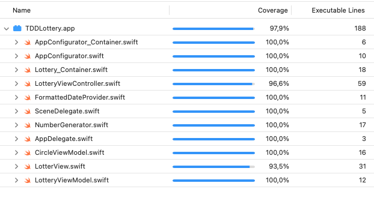
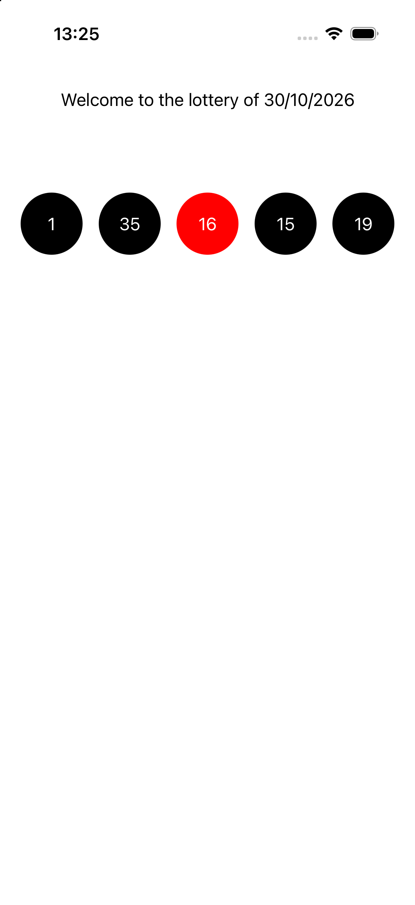

# TDD Lottery for iOS

A small Swift and UIKit lottery app demonstrating Test-Driven Development (TDD), MVVM, and dependency injection. The app generates five unique numbers and displays them with a date-based welcome message.

## Features

- **Lottery number generation:** generates five unique numbers in the inclusive range 0–42, rejecting duplicates and out-of-range values.

The app deliberately keeps its product scope small. Its engineering focus is on:

- **Separation of concerns:** MVVM keeps presentation logic separate from UIKit views and number generation.
- **Explicit dependency injection:** a composition container wires dependencies, while protocols and injected factories allow tests to substitute collaborators and control random inputs.
- **Behavior-focused tests:** tests exercise generation rules, view-model outputs, view-controller interactions, and dependency wiring. Coverage details are below.

## Test-Driven Development (TDD)

The project demonstrates TDD with tests covering number generation, date formatting, view models, view-controller behavior, dependency wiring, and app configuration. Injected factories, stubs, and spies make these behaviors testable independently.

The app target has **97.9% test coverage**, as shown in the Xcode coverage report below:



The test suite uses XCTest and Swift Testing. To run it, select the **TDDLottery** scheme in Xcode and choose **Product > Test** (⌘U). Enable code coverage in the scheme’s Test action options to generate an updated report.

## Screenshot

The app running on an iPhone, displayed at 30% of the original image width:



## Getting Started

1. Clone the repository:

   ```sh
   git clone https://github.com/bartguminiak/TDDLottery-demo-ios.git
   cd TDDLottery-demo-ios
   ```

2. Open the Xcode project:

   ```sh
   open TDDLottery/TDDLottery.xcodeproj
   ```

3. Select the **TDDLottery** scheme and an iPhone simulator running iOS 17.6 or later.
4. Choose **Product > Run** (⌘R) to launch the app.
