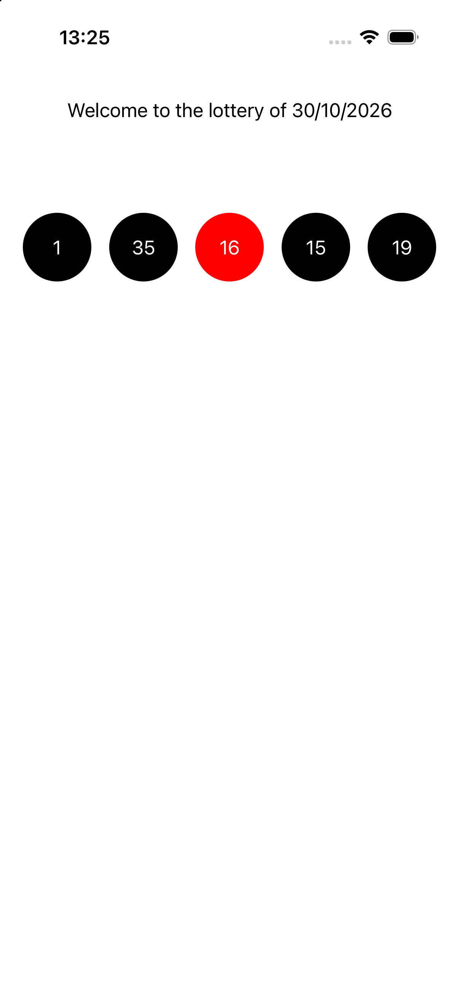

# Project Overview

This repository contains a Swift-based project developed entirely with the principles of Test-Driven Development (TDD). The application is designed for iOS and showcases a modern, clean interface with robust, well-tested features.

## Screenshot

Below is a screenshot of the app running on an iPhone:



## Features
- 100% code coverage through TDD
- Modern iOS UI
- [Add more specific features as applicable]

## Test-Driven Development (TDD)

The entire project was built using Test-Driven Development. Every feature and component was first designed as a test case before implementation, ensuring:
- High code quality
- Reliable and maintainable codebase
- Early bug detection

## Getting Started

1. Clone the repository:
   ```sh
   git clone https://github.com/your-username/your-repo-name.git
